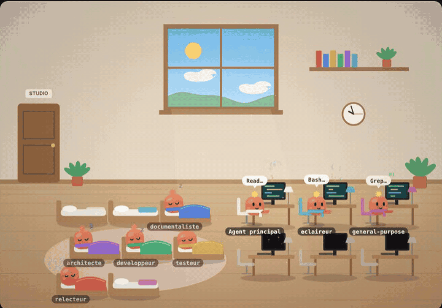
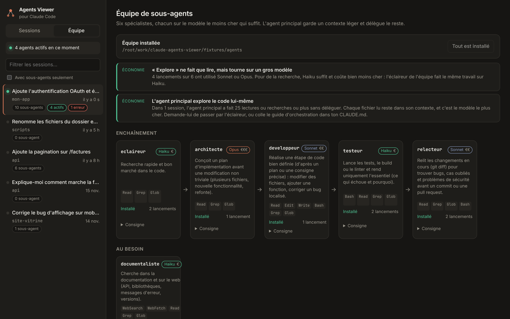

# Claude Studio

Une interface graphique locale pour **travailler avec Claude Code sans terminal** : tu choisis un projet, tu discutes avec Claude, tu le vois lire et modifier tes fichiers, et tu suis ses sous-agents en direct.



## Ce que ça fait

- **Projets** : ouvre n'importe quel dossier de ta machine. Les projets où tu as déjà utilisé Claude Code apparaissent tout seuls.
- **Discussion** : écris à Claude comme dans le terminal. Sa réponse s'affiche au fur et à mesure, chaque action est résumée en clair (« Lit src/App.tsx », « Lance les tests »…), et tu peux déplier pour voir la commande exacte et le résultat.
- **Permissions** : quand Claude veut modifier un fichier ou lancer une commande, il te demande avec des boutons *Autoriser*, *Toujours autoriser* ou *Refuser*. Trois modes au choix : *Demander avant d'agir*, *Modifs automatiques*, *Plan seulement*.
- **Conversations** : retrouve et reprends tes conversations passées, y compris celles commencées dans le terminal.
- **Agents en direct** : à droite, Claude et ses sous-agents, avec ce que chacun est en train de faire.
- **Le studio animé** : les agents sont de petits personnages qui vivent dans une pièce. Ils dorment dans le coin repos (avec des « Zzz »), marchent jusqu'à un bureau quand on leur confie une tâche, tapent sur leur clavier pendant que du code s'envole de l'écran, et les sous-agents entrent et sortent par la porte. La pièce passe de la nuit au jour dès que quelqu'un travaille. Il est visible en grand dans l'onglet Bureau, en petit à côté de la discussion, et sur l'écran d'accueil.
- **Équipe** : six sous-agents prêts à l'emploi pour dépenser moins (voir plus bas).

Tout reste sur ta machine : le serveur n'écoute que sur `127.0.0.1` et refuse les requêtes venues d'autres sites.


## Démarrage

Il faut **Node.js 20+** et **Claude Code déjà connecté** (si la commande `claude` marche dans ton terminal, c'est bon : l'appli utilise la même connexion).

```bash
git clone https://github.com/yudainaC/claude-agents-viewer
cd claude-agents-viewer
npm install
```

### En appli de bureau (conseillé)

L'appli de bureau est faite avec [Tauri](https://tauri.app) : une fenêtre native légère, sans navigateur. Il faut **Rust** une seule fois ([rustup.rs](https://rustup.rs)) et, selon ton système :

- **macOS** : `xcode-select --install`
- **Windows** : les « Microsoft C++ Build Tools » (WebView2 est déjà installé sur Windows 10/11)
- **Linux** : `sudo apt install libwebkit2gtk-4.1-dev libgtk-3-dev librsvg2-dev` (voir les [prérequis Tauri](https://tauri.app/start/prerequisites/))

```bash
npm run app
```

La première fois, la compilation prend quelques minutes, ensuite c'est rapide. Claude Studio s'ouvre dans sa propre fenêtre et arrête son serveur local quand tu la fermes.

Pour fabriquer une application installable (`.dmg`, `.msi`, `.deb`…) : `npm run app:build`. Elle se retrouve dans `src-tauri/target/release/bundle/` et utilise le dossier cloné, garde-le en place.

### Dans le navigateur

```bash
npm run dev
```

Puis ouvre http://127.0.0.1:4317. Pour une version compilée : `npm run build` puis `npm start`.

Ensuite, clique sur **Ouvrir un projet**, choisis ton dossier, et écris ta première demande.

| Variable     | Par défaut   | Rôle                                    |
|--------------|--------------|-----------------------------------------|
| `CLAUDE_DIR` | `~/.claude`  | Dossier de configuration de Claude Code |
| `PORT`       | `4317`       | Port du serveur                         |

## L'équipe de sous-agents



Six sous-agents Claude Code (dans `.claude/agents/`), chacun **limité à sa spécialité par ses outils** : un agent ne peut pas faire le travail d'un autre, même s'il le voulait.

| Sous-agent       | Modèle | Outils | Ce qu'il fait (et seulement ça) |
|------------------|--------|--------|------|
| `eclaireur`      | Haiku  | Read, Grep, Glob | Trouve où est le code, rend un rapport court. Lecture seule. |
| `documentaliste` | Haiku  | WebSearch, WebFetch, Read, Grep, Glob | Cherche dans la doc et sur le web, avec les sources. Lecture seule. |
| `architecte`     | Opus   | Read, Grep, Glob | Conçoit le plan d'une modification. Ne code pas. |
| `developpeur`    | Sonnet | Read, Edit, Write, Grep, Glob | **Le seul qui modifie le code.** Pas de commandes. |
| `testeur`        | Sonnet | Bash, Read, Grep, Glob | **Le seul qui lance des commandes** (tests, build). Ne modifie rien. |
| `relecteur`      | Sonnet | Read, Grep, Glob | Relit les changements et signale les vrais bugs. |

Les Haiku ne touchent jamais au code : ils lisent et cherchent, c'est tout.

### Mode équipe

Dans Claude Code, un sous-agent ne peut pas appeler un autre sous-agent. C'est donc le Claude principal qui fait passer le travail : avec l'interrupteur **Mode équipe** (activé par défaut, sous la zone de message), il devient **chef de projet**. Il n'a plus le droit de modifier des fichiers ni de lancer des commandes (bloqué par un hook, pas seulement par une consigne) et enchaîne l'équipe selon les règles de [`team/orchestration.md`](team/orchestration.md) :

éclaireur → architecte → développeur → testeur → relecteur, avec jusqu'à 3 allers-retours de correction entre testeur/relecteur et développeur.

En mode équipe, les sous-agents sont fournis directement par l'appli : rien à installer. Pour t'en servir aussi dans le terminal, installe-les depuis l'onglet **Équipe** (« Installer l'équipe ») ou avec `npm run install-team` : ils vont dans `~/.claude/agents`.

## Comment ça marche

- La discussion passe par le [Claude Agent SDK](https://www.npmjs.com/package/@anthropic-ai/claude-agent-sdk), c'est-à-dire Claude Code lui-même : mêmes outils, mêmes réglages (`CLAUDE.md`, sous-agents, permissions) que dans le terminal.
- Les agents en direct et le bureau lisent les transcripts que Claude Code écrit dans `~/.claude/projects` (un fichier par session, et un par sous-agent dans `<session>/subagents/`).

## Développement

```bash
npm test          # tests (parseur, équipe, discussion)
npm run typecheck
npm run demo      # données factices pour le bureau et l'équipe
```

```
server/   index.ts (API), chat.ts (Claude Agent SDK), projects.ts, parser.ts (transcripts),
          office.ts (bureau), team.ts (équipe), types.ts
src/      App.tsx, Chat.tsx, World.tsx (studio animé, canvas), AgentsPanel.tsx, Office.tsx, Team.tsx,
          FolderPicker.tsx, styles.css
src-tauri/ appli de bureau Tauri (lance le serveur, ouvre la fenêtre)
desktop/  icône et page de démarrage de l'appli
.claude/agents/  l'équipe de sous-agents
team/     orchestration.md (guide à coller dans CLAUDE.md)
```

## Licence

MIT
