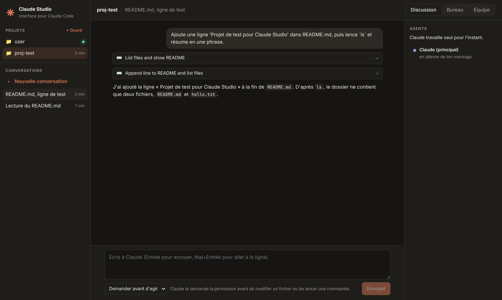
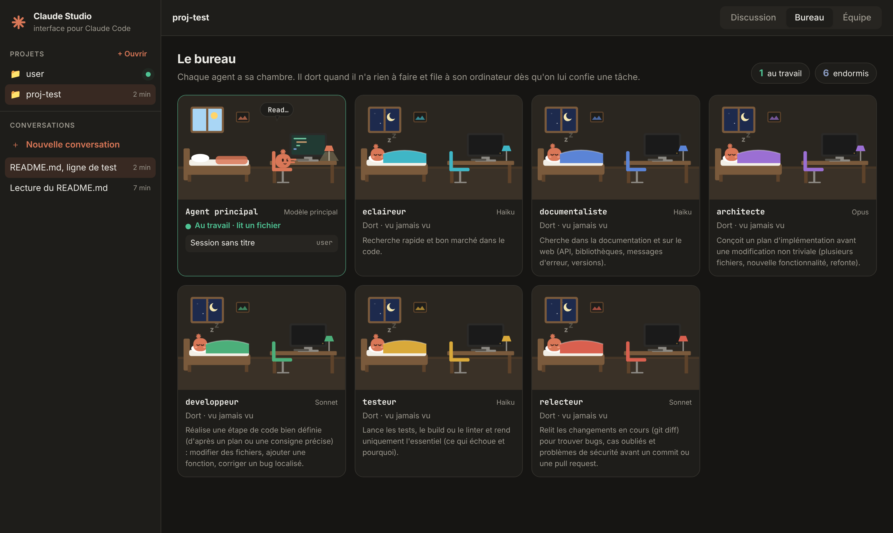

# Claude Studio

Une interface graphique locale pour **travailler avec Claude Code sans terminal** : tu choisis un projet, tu discutes avec Claude, tu le vois lire et modifier tes fichiers, et tu suis ses sous-agents en direct.



## Ce que ça fait

- **Projets** : ouvre n'importe quel dossier de ta machine. Les projets où tu as déjà utilisé Claude Code apparaissent tout seuls.
- **Discussion** : écris à Claude comme dans le terminal. Sa réponse s'affiche au fur et à mesure, chaque action est résumée en clair (« Lit src/App.tsx », « Lance les tests »…), et tu peux déplier pour voir la commande exacte et le résultat.
- **Permissions** : quand Claude veut modifier un fichier ou lancer une commande, il te demande avec des boutons *Autoriser*, *Toujours autoriser* ou *Refuser*. Trois modes au choix : *Demander avant d'agir*, *Modifs automatiques*, *Plan seulement*.
- **Conversations** : retrouve et reprends tes conversations passées, y compris celles commencées dans le terminal.
- **Agents en direct** : à droite, Claude et ses sous-agents, avec ce que chacun est en train de faire.
- **Bureau** : chaque agent a sa petite chambre. Il dort dans son lit quand il n'a rien à faire et s'installe à son ordinateur dès qu'il travaille.
- **Équipe** : six sous-agents prêts à l'emploi pour dépenser moins (voir plus bas).

Tout reste sur ta machine : le serveur n'écoute que sur `127.0.0.1` et refuse les requêtes venues d'autres sites.



## Démarrage

Il faut **Node.js 20+** et **Claude Code déjà connecté** (si la commande `claude` marche dans ton terminal, c'est bon : l'appli utilise la même connexion).

```bash
git clone https://github.com/yudainaC/claude-agents-viewer
cd claude-agents-viewer
npm install
npm run dev
```

Ouvre http://127.0.0.1:4317, clique sur **Ouvrir un projet**, choisis ton dossier, et écris ta première demande.

Pour une version compilée : `npm run build` puis `npm start`.

| Variable     | Par défaut   | Rôle                                    |
|--------------|--------------|-----------------------------------------|
| `CLAUDE_DIR` | `~/.claude`  | Dossier de configuration de Claude Code |
| `PORT`       | `4317`       | Port du serveur                         |

## L'équipe de sous-agents


Six sous-agents Claude Code (dans `.claude/agents/`), chacun sur le modèle le moins cher qui suffit, pour que l'agent principal garde un contexte léger :

| Sous-agent       | Modèle | Rôle |
|------------------|--------|------|
| `eclaireur`      | Haiku  | Trouve où est le code et rend un rapport court |
| `documentaliste` | Haiku  | Cherche dans la doc et sur le web, avec les sources |
| `architecte`     | Opus   | Conçoit le plan d'une modification non triviale |
| `developpeur`    | Sonnet | Réalise une étape précise du plan et la vérifie |
| `testeur`        | Haiku  | Lance les tests et ne rend que les échecs |
| `relecteur`      | Sonnet | Relit le diff et signale les vrais bugs |

Installe-les depuis l'onglet **Équipe** (bouton « Installer l'équipe ») ou avec `npm run install-team`. Ils vont dans `~/.claude/agents` et servent dans tous tes projets, que tu passes par l'appli ou par le terminal. Colle ensuite le guide (bouton « Copier le guide ») dans `~/.claude/CLAUDE.md` pour que Claude sache à qui déléguer.

## Comment ça marche

- La discussion passe par le [Claude Agent SDK](https://www.npmjs.com/package/@anthropic-ai/claude-agent-sdk), c'est-à-dire Claude Code lui-même : mêmes outils, mêmes réglages (`CLAUDE.md`, sous-agents, permissions) que dans le terminal.
- Les agents en direct et le bureau lisent les transcripts que Claude Code écrit dans `~/.claude/projects` (un fichier par session, et un par sous-agent dans `<session>/subagents/`).

## Développement

```bash
npm test          # tests (parseur, équipe, discussion)
npm run typecheck
npm run demo      # données factices pour le bureau et l'équipe
```

```
server/   index.ts (API), chat.ts (Claude Agent SDK), projects.ts, parser.ts (transcripts),
          office.ts (bureau), team.ts (équipe), types.ts
src/      App.tsx, Chat.tsx, AgentsPanel.tsx, Office.tsx, Team.tsx, FolderPicker.tsx, styles.css
.claude/agents/  l'équipe de sous-agents
team/     orchestration.md (guide à coller dans CLAUDE.md)
```

## Licence

MIT
